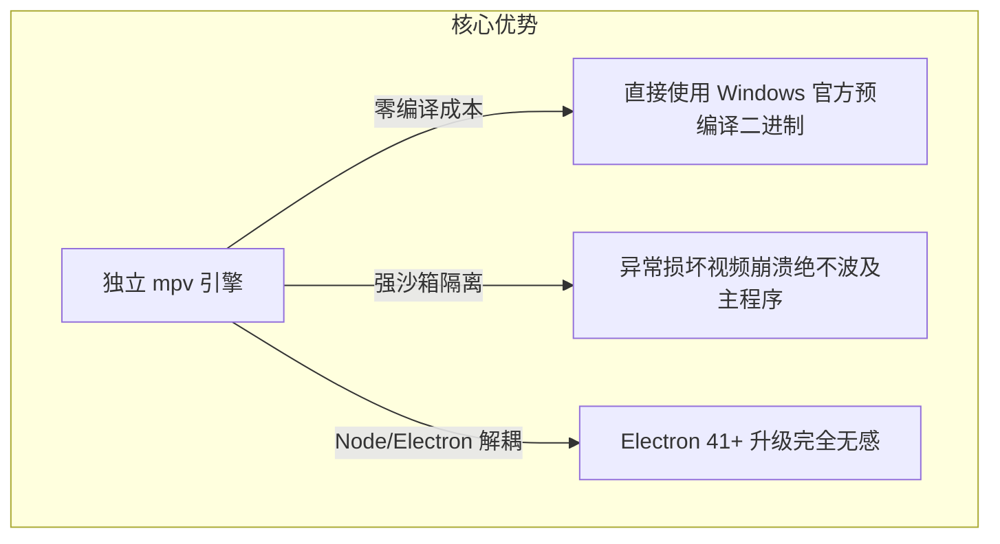
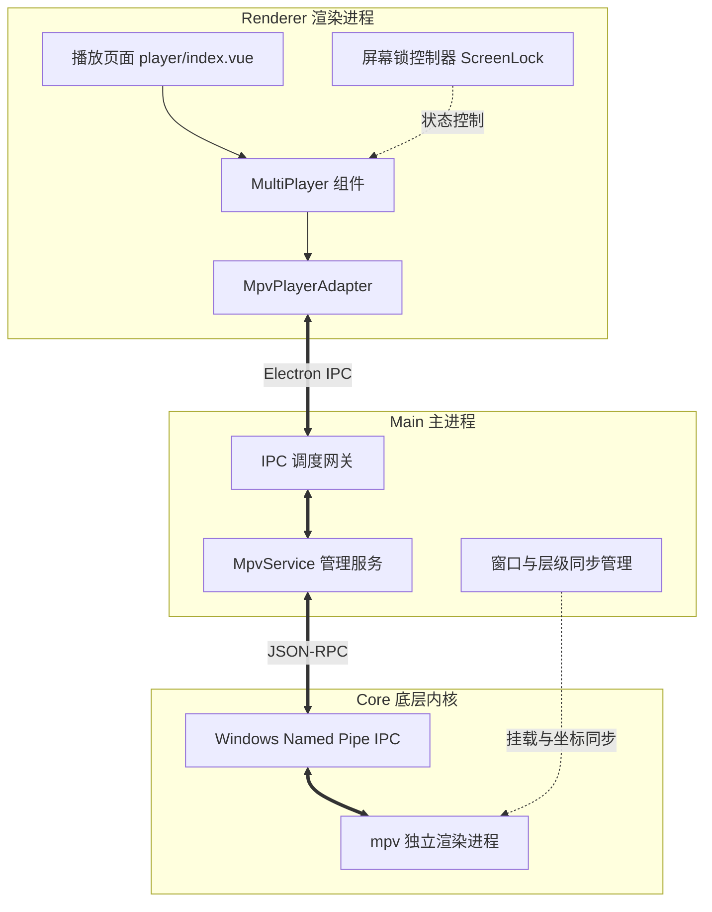

# Windows 平台集成 libmpv 全能播放器内核规划方案（已确认）

## 一、方案目标与用户已确认决策

针对本项目在 Windows 环境下播放**网盘原画（MKV 容器、DTS/杜比音频、内嵌 ASS/PGS 特效字幕等）**面临的解码瓶颈，集成 **mpv** 全能播放器内核，并落实现代播放器的核心易用性功能：

1. **全格式硬解**：全面支持 MKV、ISO、HEVC/H.265、AV1、DTS、TrueHD、杜比视界等格式；
2. **音轨自由切换**：自动提取视频流/容器中的所有音频轨道（国语/粤语/原声/多声道等），支持随时平滑切换；
3. **字幕完美支持**：
   * 完美支持内嵌 ASS/SSA 特效字幕、PGS 图形字幕、SRT；
   * **网盘同名外挂字幕自动检测与挂载**：网盘/AList 目录下存在同名 `.srt` / `.ass` / `.vtt` 时，默认自动识别并挂载加载；
4. **统一架构与默认策略**：
   * 将 `mpv` 作为播放器设置项并**设为全局默认播放器**；
   * **保留 `ArtPlayer` 与 `XgPlayer`**，供用户在设置中自由切换；
5. **屏幕锁功能（防误触锁屏）**：
   * 增加屏幕锁定按钮（浮动于播放画面左侧边缘）；
   * 锁屏后，顶部标题栏、底部控制条、侧边栏折叠按钮及快捷键全面隐藏和拦截，仅保留解锁按钮；点击解锁后方可恢复控制；
   * **无感沉浸体验**：完全不弹中央提示文字或 Toast，仅通过锁形图标自身的开/合状态切换给予视觉反馈，确保观影过程零打扰。

---

## 二、技术路线评估与选型

在 Windows + Electron 架构下，集成 mpv 采用：
**路线 2：独立 `mpv` 引擎 + Windows 命名管道（Named Pipe JSON-RPC）通信 + 原生窗口嵌入**。

---

## 三、系统整体架构设计

---

## 四、核心功能设计

### 1. 播放器设置与默认项
* **配置层**：
  * 修改 `src/renderer/src/config/player.ts`，将默认 `player.type` 更新为 `'mpv'`；
  * 更新 `src/renderer/src/pages/setting/components/base/index.vue` 中的播放器选项列表：
    - `mpv`（推荐/默认）
    - `artplayer`
    - `xgplayer`
    - `custom`（调用外部播放器）
  * 保持多播放器并存，用户可无缝自由切换。

### 2. 网盘同名外挂字幕自动检测与挂载
* **检测机制**（以 AList / WebDAV 驱动为例）：
  * 在获取视频文件详情或目录列表时，扫描同级目录下的所有文件；
  * 提取文件名主干（如 `Avatar.2009.Extended.1080p.mkv` 主干为 `Avatar.2009.Extended.1080p`）；
  * 匹配同主干且后缀为 `.srt`、`.ass`、`.ssa`、`.vtt` 的字幕文件；
  * 支持多语言后缀识别（如 `.zh-CN.ass`、`.en.srt`、`.chs&eng.ass`）；
* **自动挂载**：
  * 将检测到的字幕列表封装为 `subtitles: [{ name: '简体中文', url: '...' }]` 随播放选项传入；
  * `mpv` 收到后通过 `command("sub-add", url, "select")` 自动加载并设置为当前字幕。

### 3. 屏幕锁（防误触锁屏）功能设计
* **界面表现**：
  * 在视频左侧中间位置（参考主流移动端/PC 端播放器规范），放置一个浮动半透明锁定图标按钮：
    - 未锁定状态：悬浮显示开锁图标 `<LockOffIcon>`，点击锁定；
    - 锁定状态：悬浮显示闭锁图标 `<LockOnIcon>`；
    - **无感沉浸体验**：完全不弹中央提示文字或 Toast，仅通过锁形图标自身的开/合状态切换给予视觉反馈，确保观影过程零打扰；
* **锁定生效时的行为控制**：
  * **UI 隐藏**：顶部标题栏（TitleBar）、底部控制面板（进度条、播放暂停、音量、全屏等）、右侧侧边栏停靠按钮（Dock）全部隐藏；
  * **交互拦截**：鼠标在视频区域移动不再唤出常规控制条；
  * **快捷键屏蔽**：屏蔽空格键（暂停/播放）、方向键（快进快退/音量）等热键，防止键盘误触；
  * **解锁流程**：鼠标移动到锁屏按钮上，点击闭锁图标，平滑切换回开锁图标，恢复所有界面与热键操作。
* **通用性**：该屏幕锁做在 `MultiPlayer` / 播放页面层级，**同时兼容 mpv、ArtPlayer 和 XgPlayer**！

### 4. 音轨与字幕切换系统
* **音轨信息**：
  * 订阅 mpv 属性 `track-list`，提取所有音频轨道（`type === "audio"`）；
  * 获取轨道名称、语言（国语/粤语/英语）、编码（AAC/DTS/TrueHD/AC3）、声道信息；
  * 用户在控制栏/设置菜单点击后，发送 `set_property("aid", id)` 实时切换。
* **内嵌与外挂字幕管理**：
  * 统一将内嵌字幕与外挂字幕整合进同一个字幕列表菜单中；
  * 支持通过 `set_property("sid", id)` 自由切换，并支持 `sid = "no"` 一键关闭字幕；
  * 提供 `sub-delay` 偏移微调（支持 +/- 0.5 秒时间轴校准）。

---

## 五、分阶段实施里程碑

### 阶段 1：屏幕锁功能实现（全播放器通用）
* [ ] 在播放器组件上增加浮动锁屏控制器（Lock Button）；
* [ ] 增加锁屏状态机（屏蔽鼠标悬停事件、隐藏控制条、阻断全局快捷键）；
* [ ] 验证无弹窗静默切换与防误触表现。

### 阶段 2：网盘同名外挂字幕自动检测
* [ ] 在 AList/CMS 解析层实现同目录下字幕文件的识别与主干名匹配算法；
* [ ] 在视频数据模型中扩展 `subtitles` 字段，将匹配到的字幕直链一并返回；
* [ ] 在播放器初始化阶段自动挂载并优先选中中文字幕。

### 阶段 3：mpv 引擎引入与主进程服务
* [ ] 引入 Windows 版 `mpv.exe` 执行体至资源目录；
* [ ] 编写主进程 `MpvService`，实现 Windows 命名管道通信客户端（JSON-RPC）；
* [ ] 实现进程启动、守护、参数装配与 HWND 窗口句柄嵌入。

### 阶段 4：MpvPlayerAdapter 与音轨/字幕切换
* [ ] 实现 `MpvPlayerAdapter`，完成播放、暂停、进度跳转、音量、倍速等标准接口；
* [ ] 监听 `track-list` 事件，实时提取多音轨与多字幕清单；
* [ ] 实现音轨切换（`setAudioTrack`）、字幕切换（`setSubtitleTrack`）及外挂加载（`sub-add`）。

### 阶段 5：设置项整合与完整联调验证
* [ ] 将 `mpv` 添加至播放器设置项并置为默认播放器（保留 ArtPlayer/XgPlayer）；
* [ ] 在播放界面挂载音轨选择和字幕选择菜单；
* [ ] 使用实际网盘 MKV 原画资源进行多音轨切换与 ASS 字幕渲染联调测试；
* [ ] 运行 `pnpm lint`、`pnpm test` 并完成代码格式化。
